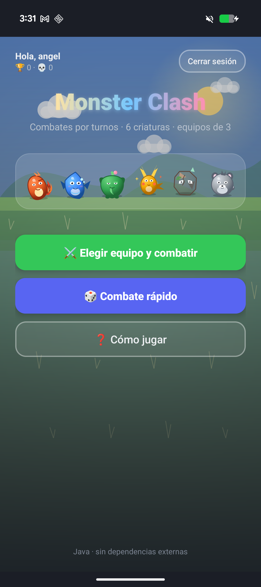
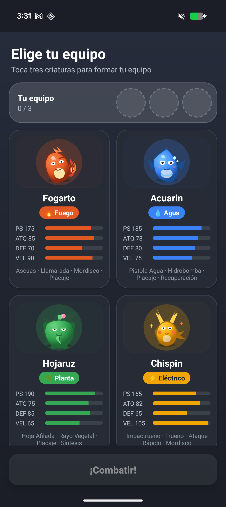
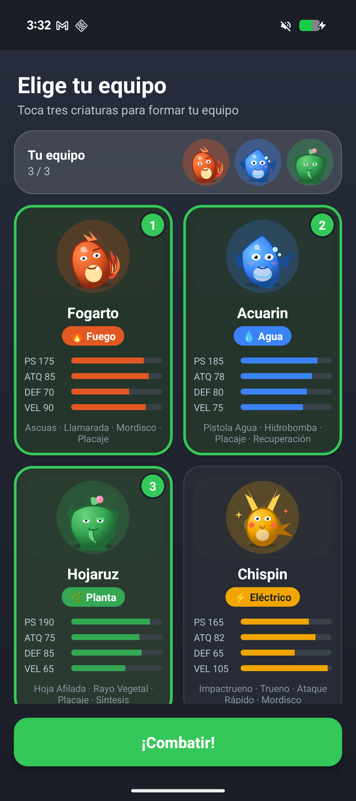
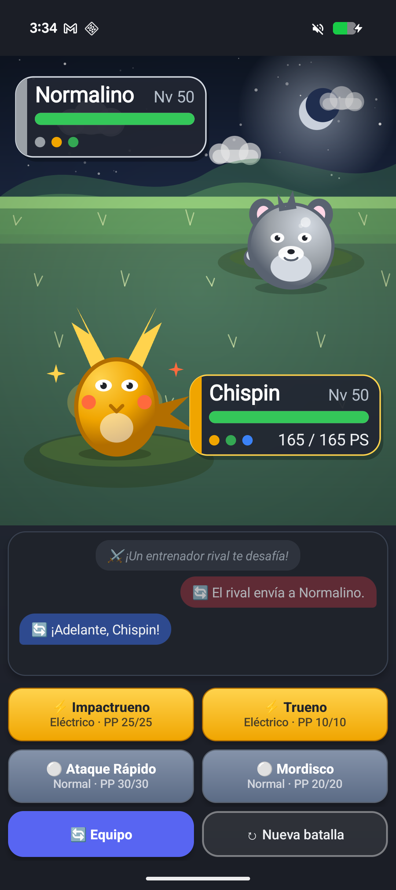
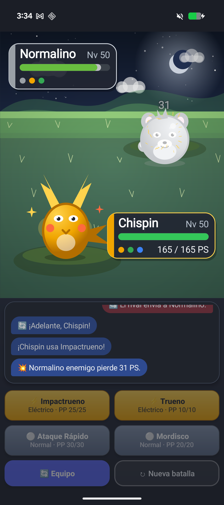
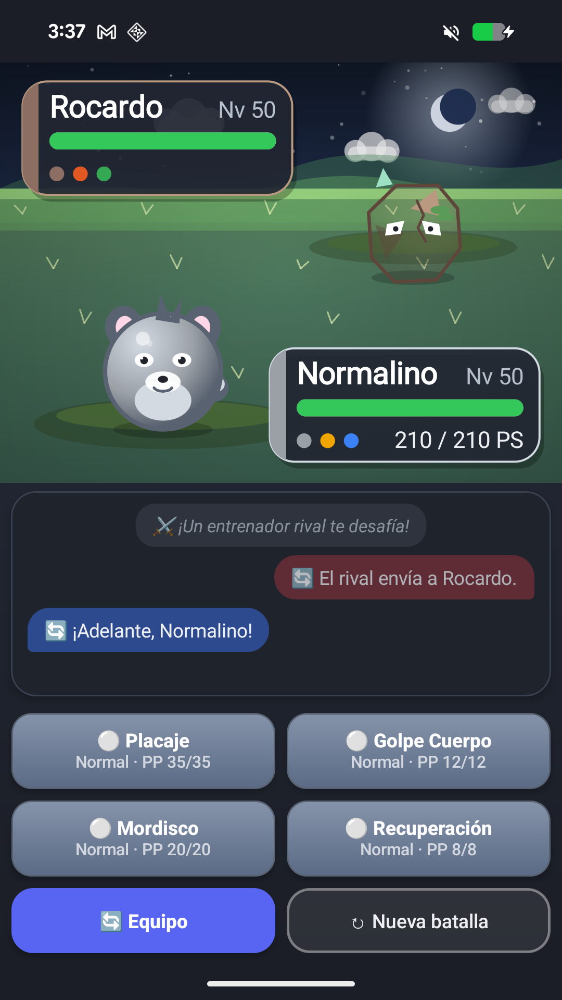

# Monster Clash 🔥💧🌿

**Proyecto de Programación Multimedia y Dispositivos Móviles (2º DAM)**

Juego de combates por turnos estilo Pokémon para Android, hecho en **Java** sin librerías externas:

- **Cero dependencias**: ni AndroidX ni librerías de terceros, solo el SDK de Android. Así entiendo qué hace cada cosa sin que una librería me lo esconda.
- **Interfaz en XML**: el login, la recuperación de contraseña, el menú, la selección de equipo y el combate están en `res/layout/` (textos en `strings.xml`, colores en `colors.xml`, medidas en `dimens.xml`) y se pueden tocar desde el editor de diseño de Android Studio. Los layouts llevan `tools:text` con textos de ejemplo para la vista previa.
- **Gráficos con Canvas**: el escenario, las criaturas, las barras de vida y la animación los dibujo con figuras (círculos, óvalos, triángulos), sin imágenes. Son las vistas `VistaBatalla`, `VistaCriatura` y `VistaConfeti`, con los ayudantes `Escenario`, `Particulas`, `TextosFlotantes` y `PanelCriatura`.
- **Cuentas offline**: login y registro con SQLite dentro del móvil (contraseñas con PBKDF2, bloqueo por intentos y recuperación con pregunta de seguridad), sin servidor ni permiso de Internet. Ver [docs/LOGIN.md](docs/LOGIN.md).

## Capturas

| Login | Selección de equipo | Equipo elegido |
| :---: | :---: | :---: |
|  |  |  |

| Combate | Impacto | Combate a 1080×1920 |
| :---: | :---: | :---: |
|  |  |  |

El escenario del combate cambia según la hora del móvil (día, tarde y noche).

El menú y los combates tienen música chiptune original generada por la app, sin
descargas ni archivos de terceros. Las decisiones de seguridad están resumidas
en [docs/SEGURIDAD.md](docs/SEGURIDAD.md).

## Cómo compilarlo e instalarlo

### Opción A: APK ya hecho

En la [última versión publicada](https://github.com/angel63652/combates-monstruo/releases/latest) hay un APK. Se descarga en el móvil, se abre y se acepta instalar apps de origen desconocido.

> **Aviso:** el APK que hay ahora en *releases/latest* es anterior al login offline (arranca directamente en el menú y no guarda partidas). Hasta que publique una release nueva, para probar las cuentas hay que compilar el proyecto con la opción B o la C.

### Opción B: Android Studio

1. Android Studio (2026.1 «Quail» o más nuevo) → **Open** → carpeta `JuegoCombates`.
2. Esperar a que sincronice Gradle (el *wrapper* descarga solo la versión correcta, la 9.5).
3. Conectar el móvil con la **depuración USB** activada y pulsar **Run ▶**.

### Opción C: línea de comandos

Con el SDK de Android instalado y `ANDROID_HOME` (o `local.properties` con `sdk.dir`) apuntando a él:

```
cd JuegoCombates
./gradlew assembleDebug        # en Windows: gradlew.bat assembleDebug
adb install app/build/outputs/apk/debug/app-debug.apk
```

Versiones: Gradle 9.5 (wrapper), plugin de Android 9.3.1, `compileSdk 36`, `targetSdk 34`, `minSdk 24` y JDK 17 o superior (el de Android Studio vale).

Requisitos del móvil: Android 7.0 (API 24) o superior.

## Cómo se juega

- Tu equipo de **3 criaturas** contra el de un rival controlado por la IA. El equipo del rival es aleatorio; el tuyo lo eliges o lo dejas al azar con "Combate rápido".
- Eliges uno de los **4 movimientos** de tu criatura activa. El orden de acción lo decide la **velocidad**.
- El botón **Equipo** cambia de criatura (gasta el turno). Si la tuya se debilita, el cambio es gratis.
- Ganas cuando las 3 criaturas rivales se debilitan.
- El botón **Cómo jugar** del menú resume estas reglas dentro de la app.

## Cuentas (login offline)

La app arranca por `LoginActivity`. Se puede **crear una cuenta**, **entrar** con una que ya exista o **jugar sin cuenta** (invitado). Con sesión, el menú saluda al usuario, enseña sus victorias y derrotas y cada combate terminado se apunta en la base de datos.

- Todo es local: una base de datos SQLite (`monsterclash.db`) en la carpeta privada de la app, sin servidor, sin API y sin permiso de Internet. `BaseDatos` (un `SQLiteOpenHelper`) crea cuatro tablas: `usuarios`, `partidas`, `intentos_nombre` y `ajustes`.
- Las contraseñas se guardan como hash **PBKDF2-HMAC-SHA256** (salt de 16 bytes, 120000 iteraciones), implementado a mano sobre `javax.crypto.Mac` en `datos/Hash.java`. La clase no usa nada de Android, así que se compila con el `javac` del PC y `pruebas/com/juego/combates/datos/PruebaHash.java` la comprueba contra vectores de prueba conocidos (ver [Pruebas](#pruebas)).
- Tras **5 contraseñas mal** la cuenta se bloquea 15 minutos, medidos con `elapsedRealtime` y el contador de arranques (`ControlBloqueo`) para que cambiar la hora del móvil no lo salte. Un nombre que no existe recibe los mismos mensajes, tarda lo mismo y se bloquea igual (tabla `intentos_nombre`): no se puede saber qué cuentas hay.
- **Recuperar la contraseña** (`RecuperarActivity`): usuario → pregunta de seguridad (elegida al crear la cuenta, respuesta hasheada) → contraseña nueva. También con 5 intentos y bloqueo, y sin decir nunca si el usuario existe. El paso 3 solo se acepta con un permiso de un solo uso (`TokenRecuperacion`, en memoria) que da el paso 2 al acertar la pregunta y que caduca a los 10 minutos.
- La sesión guarda solo id y nombre en `SharedPreferences`; `allowBackup="false"` más `dataExtractionRules` para que la base de datos no salga ni en las copias de seguridad ni en la transferencia a otro móvil.

Detalles, esquema de tablas y qué protege (y qué no) en [docs/LOGIN.md](docs/LOGIN.md).

## Mecánicas

- **6 tipos** (Normal, Fuego, Agua, Planta, Eléctrico, Roca) con tabla de efectividades (×2, ×1, ×0.5).
- **STAB**: los movimientos del mismo tipo que la criatura hacen un 50% más de daño.
- **Golpes críticos** (1 de cada 12, daño ×1.5), **precisión** por movimiento y **PP** limitados (sin PP → Forcejeo).
- Fórmula de daño inspirada en la clásica de Pokémon, con variación aleatoria del 85–100%.
- **IA rival**: elige el ataque con mayor daño esperado (con un 20% de aleatoriedad), se cura cuando está baja de vida y, al caer una criatura, saca la que mejor tipo tenga contra la tuya.

## Editar la interfaz

Con el editor de diseño (pestaña **Design**) sobre:

- `res/layout/activity_login.xml` — inicio de sesión / crear cuenta.
- `res/layout/activity_recuperar.xml` — recuperar la contraseña (3 pasos).
- `res/layout/activity_menu.xml` — menú de inicio (con la fila de usuario).
- `res/layout/activity_seleccion.xml` + `res/layout/item_criatura.xml` — elegir equipo.
- `res/layout/activity_combate.xml` — pantalla de combate (escenario, chat y botones).
- `res/layout/dialogo_equipo.xml` + `res/layout/item_equipo_dialogo.xml` — diálogo de cambio de criatura.
- `res/layout/dialogo_fin.xml` — diálogo de victoria / derrota.
- `res/values/strings.xml` — textos (botones, diálogos, ayuda, login).
- `res/values/arrays.xml` — las preguntas de seguridad (no cambiar el orden: en la BD se guarda el índice).
- `res/values/colors.xml` — colores de la interfaz.
- `res/values/dimens.xml` — tamaños y márgenes.

El fondo del combate (cielo, astro, nubes, colinas, hierba y plataformas) se dibuja por código en `vistas/Escenario.java`, las criaturas en `vistas/DibujoCriatura.java` y la composición del combate (criaturas animadas, partículas, números y paneles) en `vistas/VistaBatalla.java`. Los ids de los layouts van sin prefijo salvo en los que comparten campos o pantalla con otro: `rec_` en recuperar (repite los campos del login), `dlg_` y `fin_` en los dos diálogos (se inflan dentro del combate). Los colores base de cada criatura están en `modelo/Tipo.java` y la paleta visual por tipo (sombra, luz, acento, color de botón y fondo de tarjeta) en `vistas/Paleta.java`, que es donde se edita el aspecto. Los mensajes del combate («¡X usa Y!», «¡Golpe crítico!»…) están en `batalla/Batalla.java`, porque el motor no depende de Android.

## Pruebas

Las clases de `modelo/`, `batalla/` y `datos/Hash.java` no usan `android.*`, así que se prueban con el JDK del PC, sin emulador. Los programas de prueba están en `pruebas/` y los comandos se lanzan desde la raíz del proyecto (Git Bash). Más detalle en [pruebas/README.md](pruebas/README.md).

**Arnés del motor** (`pruebas/ArnesBatalla.java`): juega 300 combates con semillas fijas y vuelca cada evento. La salida tiene que coincidir con `pruebas/referencia_motor.txt`; si el `diff` imprime algo, el motor ha cambiado de comportamiento.

```
javac -encoding UTF-8 -d pruebas/salida pruebas/ArnesBatalla.java app/src/main/java/com/juego/combates/modelo/*.java app/src/main/java/com/juego/combates/batalla/*.java
java -Dfile.encoding=UTF-8 -Dstdout.encoding=UTF-8 -cp pruebas/salida ArnesBatalla > pruebas/salida/actual.txt
diff --strip-trailing-cr pruebas/referencia_motor.txt pruebas/salida/actual.txt
```

**Autocomprobación de PBKDF2** (`pruebas/com/juego/combates/datos/PruebaHash.java`): compara `Hash.java` con vectores de prueba conocidos.

```
javac -encoding UTF-8 -d pruebas/salida app/src/main/java/com/juego/combates/datos/Hash.java pruebas/com/juego/combates/datos/PruebaHash.java && java -cp pruebas/salida com.juego.combates.datos.PruebaHash
```

## Estructura del código

```
JuegoCombates/
├── README.md                         # Este archivo
├── docs/
│   ├── LOGIN.md                      # Cómo funcionan las cuentas offline (tablas, hash, bloqueos)
│   ├── ANALISIS.md                   # Análisis y plan de pulido de septiembre de 2026 (histórico; el estado actual es este README)
│   └── capturas/                     # Las seis capturas de la sección "Capturas"
├── pruebas/                          # Pruebas de consola, sin Android (ver pruebas/README.md)
│   ├── README.md                     #   Comandos para compilar y ejecutar las pruebas
│   ├── ArnesBatalla.java             #   300 combates con semilla fija
│   ├── referencia_motor.txt          #   Salida esperada del arnés
│   └── com/juego/combates/datos/
│       └── PruebaHash.java           #   Vectores de prueba de PBKDF2-HMAC-SHA256
└── app/src/main/
    ├── java/com/juego/combates/
    │   ├── pantallas/                    # Las 5 Activities y sus ayudantes
    │   │   ├── LoginActivity.java        #   Entrar / crear cuenta / invitado (LAUNCHER)
    │   │   ├── RecuperarActivity.java    #   Recuperar la contraseña en 3 pasos
    │   │   ├── MenuActivity.java         #   Menú de inicio, fila de usuario y ayuda
    │   │   ├── SeleccionActivity.java    #   Elegir el equipo
    │   │   ├── CombateActivity.java      #   Flujo del combate (guarda la partida al acabar)
    │   │   ├── Transiciones.java         #   Las dos transiciones entre pantallas (adelante / atrás)
    │   │   ├── TarjetaCriatura.java      #   Cabecera común de las tarjetas de selección y del diálogo de equipo
    │   │   └── EnvioConTeclado.java      #   El "hecho" del teclado envía el formulario (login y recuperar)
    │   ├── datos/                        # Cuentas y partidas en SQLite
    │   │   ├── Hash.java                 #   PBKDF2-HMAC-SHA256 a mano (sin Android)
    │   │   ├── BaseDatos.java            #   SQLiteOpenHelper: usuarios, partidas, intentos_nombre y ajustes
    │   │   ├── Usuario.java              #   POJO de un usuario
    │   │   ├── Estadisticas.java         #   Partidas / victorias / derrotas
    │   │   ├── EstadoIntentos.java       #   Contadores y bloqueo por intentos
    │   │   ├── Validador.java            #   Reglas de usuario, contraseña y respuesta
    │   │   ├── RepositorioUsuarios.java  #   Registrar, entrar, bloqueo, recuperación
    │   │   ├── RepositorioPartidas.java  #   Guardar partidas y estadísticas
    │   │   ├── Sesion.java               #   Quién está dentro (SharedPreferences)
    │   │   ├── ControlBloqueo.java       #   Reglas del bloqueo por intentos con tres relojes
    │   │   └── TokenRecuperacion.java    #   Token de un solo uso entre la pregunta y la contraseña nueva
    │   ├── modelo/                       # Datos del juego (sin Android)
    │   │   ├── Tipo.java                 #   Enum de tipos, colores y efectividades
    │   │   ├── Movimiento.java           #   Ataques y curaciones con PP
    │   │   ├── Criatura.java             #   Estadísticas, vida y movimientos
    │   │   └── Fabrica.java              #   Las 6 especies y equipos al azar
    │   ├── batalla/                      # Reglas (sin Android)
    │   │   ├── Batalla.java              #   Turnos, daño e IA rival
    │   │   └── Evento.java               #   Un paso narrado del combate
    │   └── vistas/                       # Dibujo con Canvas
    │       ├── Paleta.java               #   Tonos visuales por tipo para UI y Canvas
    │       ├── DetalleGolpe.java         #   Datos visuales del golpe, sin android.*
    │       ├── DibujoCriatura.java       #   Cómo se dibuja una criatura
    │       ├── VistaCriatura.java        #   Una criatura suelta (menú, tarjetas)
    │       ├── VistaBatalla.java         #   Escenario del combate
    │       ├── VistaConfeti.java         #   Confeti de victoria dibujado con Canvas
    │       ├── Escenario.java            #   Cielo, astro, nubes, colinas y plataformas según la hora
    │       ├── Particulas.java           #   Partículas de impacto por tipo y de curación
    │       ├── TextosFlotantes.java      #   Números flotantes de daño y curación
    │       ├── PanelCriatura.java        #   Panel de nombre, nivel y barra de vida
    │       ├── LectorDeEventos.java      #   Saca el DetalleGolpe de los Evento del motor
    │       ├── EstiloBotonMovimiento.java  #   Botones de movimiento con la paleta de su tipo
    │       ├── ChatCombate.java          #   Burbujas del historial del combate
    │       └── Animaciones.java          #   Fundido de entrada y flotar de las criaturas
    └── res/
        ├── layout/                       # Pantallas
        ├── values/                       # strings, arrays, colors, dimens, themes
        ├── drawable/                     # Fondos, botones y velos (XML)
        ├── anim/                         # Transiciones entre pantallas
        ├── animator/                     # Pulso de botones
        ├── xml/                          # Reglas de extracción (copias y transferencia)
        └── mipmap-*/                     # Icono
```

## Decisiones de diseño

- **Cada criatura tiene su silueta.** Fogarto es inclinado y nervioso, Acuarin tiene forma de gota, Hojaruz es ancho y tranquilo, Chispin vibra con chispas, Rocardo parece pesado y Normalino es redondo (`DibujoCriatura`). El escenario tiene horizonte bajo, colinas, hierba, nubes, sol o luna y estrellas según la hora del móvil (`Escenario`, en `vistas/`).
- **Golpes leídos desde eventos, no desde el motor.** `LectorDeEventos` (en `vistas/`) mira los `Evento` que devuelve `Batalla`, calcula un `DetalleGolpe` visual y se lo pasa a `VistaBatalla` para las embestidas, esquivas, partículas por tipo (`Particulas`), números flotantes (`TextosFlotantes`) y barras de vida suavizadas (`PanelCriatura`). El motor no sabe nada de la parte visual: textos, daño y orden de azar dependen solo de `batalla/`.
- **Final de combate con pausa visual.** Antes del diálogo final dejo 1,2 s para ver el KO. En victoria se muestra la criatura decisiva con `VistaConfeti`; en derrota el escenario se desatura progresivamente.
- **Botones por tipo.** `EstiloBotonMovimiento` crea los gradientes de los movimientos en Java con `GradientDrawable` y `RippleDrawable`, y el texto enriquecido con nombre fuerte y PP más pequeño. Normal usa azul pizarra para no parecer deshabilitado.
- **Modelo, motor y hash sin Android.** `modelo`, `batalla` y `datos/Hash.java` solo usan `java.util` y `javax.crypto`, así los compilo y pruebo con el JDK del PC sin emulador: el arnés de `pruebas/ArnesBatalla.java` detecta cualquier cambio de comportamiento del motor y `PruebaHash` comprueba el PBKDF2 contra vectores conocidos.
- **Atributos privados con getters y setters** en todas las clases del modelo. Solo son públicas las constantes.
- **El turno se calcula de golpe y se enseña poco a poco.** `Batalla.ejecutarTurno()` devuelve una lista de `Evento`; `CombateActivity` los muestra uno cada 700 ms con un `Handler`. Cada `Evento` guarda la vida de las dos criaturas en ese instante para que la barra baje al leer el mensaje del golpe.
- **Sin `Thread.sleep()`**: bloquearía el hilo principal. Uso `Handler.postDelayed()` con un `Runnable` que se reprograma a sí mismo.
- **Cerrojo `ocupado`** en el combate para que dos toques rápidos no lancen dos turnos.
- **El historial del combate es un chat.** Cada `Evento` lleva un `bando` (jugador, rival o narrador) y `ChatCombate` crea una burbuja por mensaje: a la izquierda las mías, a la derecha las del rival y centradas las del narrador, con un emoji según lo que pasa.
- **Cambio de criatura con tarjetas.** El diálogo de equipo es un layout propio (`dialogo_equipo.xml`) con el dibujo, el tipo, la barra de vida y el estado de cada criatura. Al entrar una criatura nueva, `VistaBatalla` la desliza desde su lado y la escala; al caer, se encoge y se desvanece.
- **Sin librerías tampoco para la interfaz**: los botones con onda al pulsar son `<ripple>` del propio SDK, las barras de estadísticas son `ProgressBar` con un `layer-list`, las animaciones del menú y de las tarjetas son `ObjectAnimator` y `View.animate()` (compartidas en `vistas/Animaciones`), el pulso al pulsar un botón es un `StateListAnimator` (`res/animator/`) y las transiciones entre pantallas son `res/anim/` con `overridePendingTransition`, centralizadas en `pantallas/Transiciones`.
- **Criaturas nuevas en cada combate**: `Fabrica.crear()` siempre hace `new`, así dos ejemplares de la misma especie no comparten vida ni PP.
- **Listeners**: cada Activity implementa `View.OnClickListener` y en `onClick()` compruebo qué botón se pulsó. Para diálogos y `Handler` uso clases anónimas.
- **La base de datos nunca en el hilo principal.** Calcular un hash PBKDF2 tarda 100-400 ms, así que login, registro y recuperación van en un `Thread` y vuelven a la pantalla con un `Handler(Looper.getMainLooper())`; mientras, el formulario se bloquea y sale una ruedecita. El resultado del repositorio es un enum o una clase pequeña (`ResultadoLogin`, `ResultadoRegistro`, `ResultadoRecuperacion`), nada de códigos numéricos. Las reglas del bloqueo por intentos viven en `ControlBloqueo` y el permiso entre la pregunta y la contraseña nueva en `TokenRecuperacion`.
